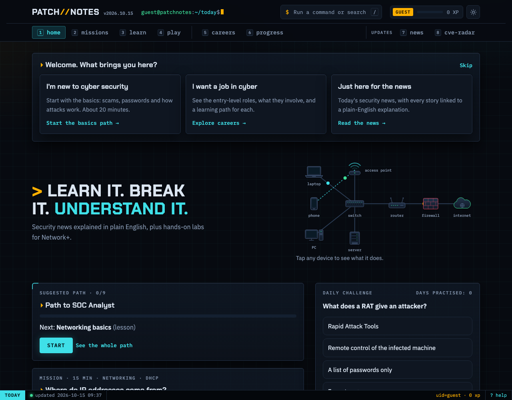
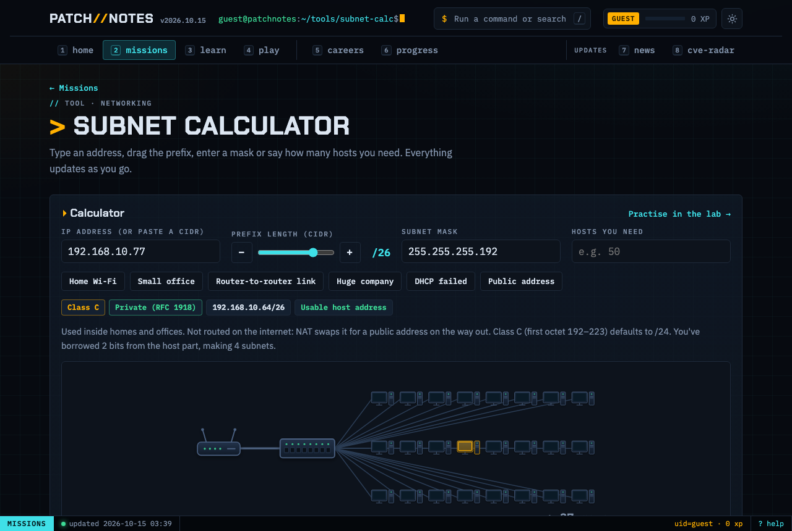
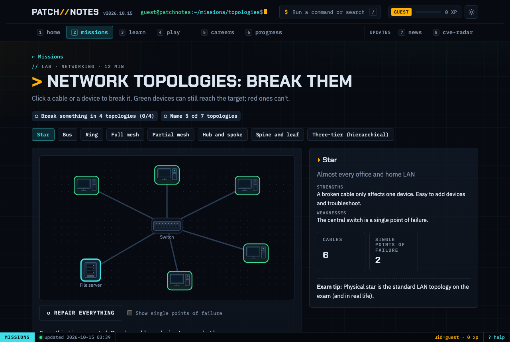
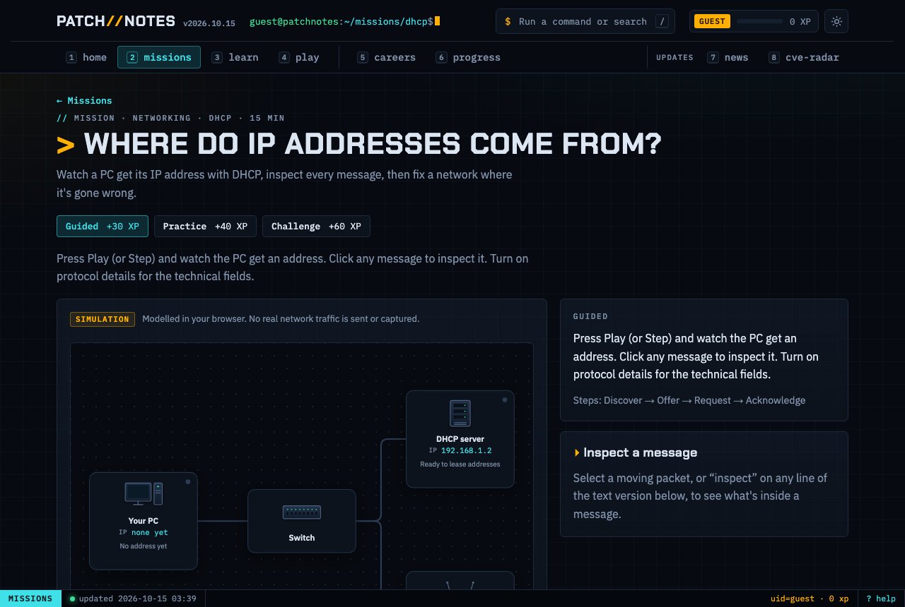
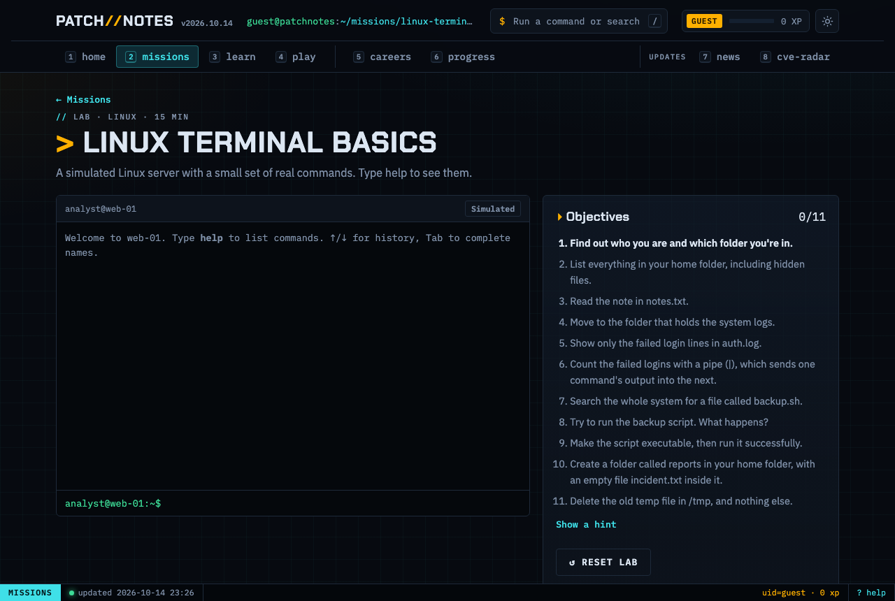
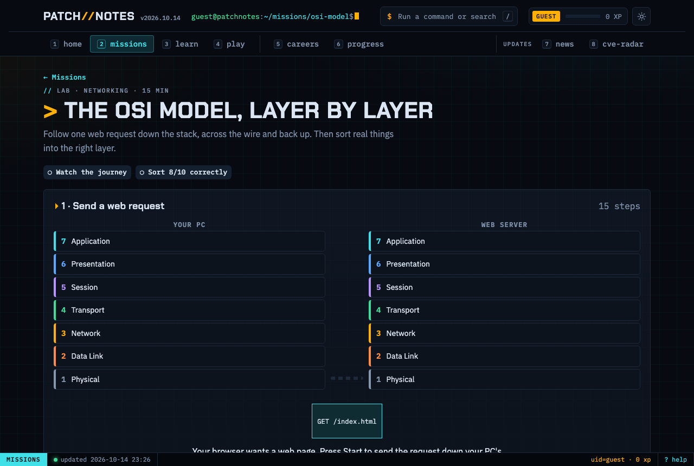
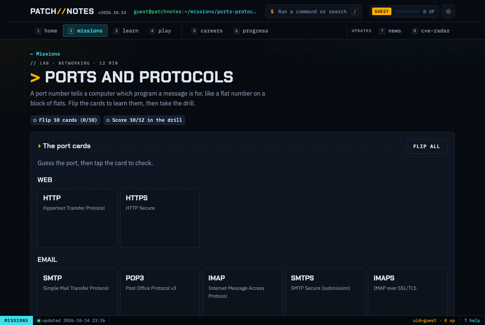

# Patch Notes

**Learn it. Break it. Understand it.** A free site for people getting into cyber security and IT, covering both sides: how attacks work (offensive security) and how to stop them (defensive security). Hands-on labs, missions and games, plus the day's security news with every headline explained.

**Live:** https://samj-01.github.io/patch-notes/



Most security news is written for people already in the industry, and most courses aren't connected to what's happening this week. Patch Notes joins the two, and teaches by letting you poke at things: break a network cable and see who loses connection, drag a subnet mask and watch the bits move, run real Linux commands against a log file.

## Missions and labs

Everything runs in the browser. Nothing is installed and no real network traffic is sent.

| | What you do | Topic |
|---|---|---|
| **DHCP mission** | Watch a PC get its IP address packet by packet (Discover, Offer, Request, Acknowledge), inspect every message, then fix a broken network. Guided, Practice and Challenge modes | IP addressing, DHCP |
| **The 3am logins** (mission) | Overnight SSH alerts on a Linux server: search `auth.log` like grep, find the one login that worked, contain the attacker (end the session, lock the account, switch to key-only SSH) and prove how they got in | Security operations, log analysis |
| **The OSI model, layer by layer** | Follow one web request down all 7 layers and back up as headers are added and removed, then sort real things into the right layer | OSI model |
| **Network topologies: break them** | Eight topologies (star, bus, ring, mesh, spine-and-leaf…). Click a cable or device to break it and see who's cut off; reveal the single points of failure | Topologies |
| **Ports and protocols** | 24 flip cards for the exam port list, insecure-to-secure swaps, then a quick-fire drill | Ports and protocols |
| **Subnetting trainer** | A live binary view of the network/host split, the block-size shortcut, and typed practice questions with worked answers | Subnetting |
| **Subnet calculator** (tool) | Type an address, drag the prefix, enter a mask or a host count: a live network diagram grows and shrinks, with class, address type (private, APIPA, loopback…), CIDR, mask, wildcard, ranges, a map of where the subnet sits, the binary AND, and a splitter for dividing a network. Shareable links, and `subnet 10.0.0.0/22` in the command palette | Subnetting, IPv4 addressing |
| **Linux terminal** | A simulated shell: navigate, read logs, `grep` with pipes (`\| wc -l`, `\| sort \| uniq -c`), fix a script's permissions | Linux CLI |
| **Log detective, Header inspector, CVSS builder** | Investigate an SSH brute force, read a spoofed email's headers, score a vulnerability with CVSS 3.1 | Security operations |

<table>
<tr>
<td></td>
<td></td>
</tr>
<tr>
<td></td>
<td></td>
</tr>
<tr>
<td></td>
<td></td>
</tr>
</table>

Wrong answers never end a lab: every quiz offers a retry of the questions you missed, and every lab has a reset button.

## The rest of the site

| Section | What it does |
|---|---|
| **Home** | Your next learning step, a daily challenge, this week in security and the vulnerabilities to patch first |
| **News** | Headlines from 12 outlets, auto-tagged by topic, linked to lessons and CVEs, with "What this means" explanations (AI-written, fact-checked against each article and official records) |
| **CVE Radar** | Every new CVE, enriched with CISA KEV and FIRST EPSS, prioritised by real-world risk, with trend charts |
| **Am I affected?** | Pick the tech you use (phone, browser, router, work apps) for personal alerts |
| **Exam prep** | CompTIA Network+ (N10-009): all 25 objectives mapped to the lessons, labs and missions that practise them, with honest coverage (4 hands-on, 13 partial, 8 not yet), per-objective progress, and an **"Am I ready?"** check: readiness per domain from your practice and question results, a study plan of what to do next, and your latest mock score. Preparation, not a guarantee; no real exam questions |
| **Learn** | 22 lessons with sourced real-world cases, 4 learning paths (e.g. Path to SOC Analyst) and a glossary of 250+ terms, including the common CWE bug types |
| **Play** | "Phish or Legit?", a quick-fire quiz and a 3-flag CTF hunt hidden in the site itself |
| **Careers** | Five entry paths with skills, certs and first job titles, plus a directory of free resources |
| **Progress** | XP, access levels (guest → root), 17 badges and an XP history |

Everywhere: jargon has a dotted underline (hover or tap for an explanation), a command palette (`/` or `Ctrl+K`) lets you navigate like a terminal, and there's a light and a dark theme.

### Points system

| Action | XP |
|---|---|
| Complete a mission | +30 to +60 (by mode) |
| Complete a lab | +30 |
| Finish a lesson | +25 |
| Daily challenge (correct) | +20 |
| Capture a hidden flag | +50 |
| Complete a learning path | +100 |
| Unlock a badge | +20 |

Progress is stored only in the visitor's browser (no accounts, no tracking). Finishing anything sets off fireworks (or a quiet card, if you've asked your device for reduced motion).

## How it works

```
news.py        12 RSS/Atom feeds ─► de-dupe ─► topic tagging ─► CVE ID extraction
cve_watch.py   NVD API ─► CISA KEV ─► FIRST EPSS ─► risk priority ─► SQLite (what's new)
content/       lessons, labs, missions, quiz, phishing emails, careers, glossary (plain JSON, easy to edit)
static/js/     the Mission Engine and lab modules (OSI, topology, terminal, ports, subnetting), loaded on demand
static/js/hw.js  the device library: one drawing per device (PC, laptop, phone, server, database, switch, hub,
               router, firewall, access point, internet, attacker), used by every diagram on the site
build.py       builds site/: the app, lazily loaded CVE data, a page per lesson, RSS feed and sitemap
tests/         Python unit tests + Node tests of the page logic, Mission Engine and every lab
.github/       GitHub Actions rebuilds and redeploys the site every morning
```

Standard-library Python only, with no frameworks or packages to install. The page is static HTML with no backend, tracking or cookies. XP and progress are stored only in the visitor's own browser.

## Run it locally

```bash
python3 build.py                        # full refresh (a few minutes: NVD rate limit)
python3 build.py --reuse-cves --serve   # refresh news only, then preview at http://localhost:8000
python3 build.py --offline --serve      # rebuild from saved data (for editing content/design)
python3 -m unittest discover -s tests   # Python tests
node --test tests/page.test.mjs tests/missions.test.mjs tests/layout.test.mjs tests/labs.test.mjs tests/flow.test.mjs tests/exam.test.mjs   # page logic + Mission Engine tests
```

A free [NVD API key](https://nvd.nist.gov/developers/request-an-api-key) makes CVE fetching about 10× faster: `export NVD_API_KEY=...`

To use it in the daily GitHub build, add it as a repository secret (it's read as `NVD_API_KEY`):

```bash
gh secret set NVD_API_KEY
```

## Put it online for free

1. Create a GitHub repository and push this folder.
2. In the repo: **Settings → Pages → Source: GitHub Actions**.
3. Optional: **Settings → Secrets → Actions** → add `NVD_API_KEY`.
4. The workflow in `.github/workflows/daily.yml` builds and publishes the site every day at 06:00 UTC.

## Daily automation

1. **GitHub Actions** (`.github/workflows/daily.yml`) runs the tests, then rebuilds and deploys the site every day at 06:00 UTC and on every push. A failing test blocks the deploy.
2. **A scheduled Claude task** on the maintainer's Mac runs each morning. It fetches the news and drafts beginner explanations for new stories and glossary entries for new jargon.
3. **Every draft is fact-checked before it goes live.** The same task gathers evidence for each draft with `python3 explain.py sources`: the original article (or, when a site blocks downloads, the publisher's own summary and other outlets' coverage of the same event) plus NIST NVD and CISA KEV records for every CVE named. Each claim is checked; drafts are published, corrected or rejected with `python3 explain.py publish`, and every decision is recorded in `content/verification_log.json`. Glossary terms are confirmed against vendor or standards-body documentation. To review by hand instead:

```bash
python3 explain.py review         # story explanations: approve / edit / reject, then push
python3 explain.py review-terms   # glossary drafts
```

If the Mac is off, step 1 still runs: news and CVEs stay current, only new explanations are skipped.

## Adding content

- **A lesson:** add an entry to `content/lessons.json`. If its `id` matches a topic in `news.py`, news stories link to it automatically.
- **Quiz questions:** add to `content/quiz.json` (`topic` links a question to a lesson).
- **Phishing emails:** add to `content/phish.json`. Use fictional companies only.
- **Your name in the footer:** set `author` in `content/site.json`.

## Skills demonstrated

- API integration and resilience: pagination, rate limits, retries, parallel fetching
- Parsing untrusted external data (RSS/Atom XML, JSON) and escaping it safely into HTML
- Vulnerability management: CVE, CWE, CVSS v2/v3/v4, EPSS, KEV, risk-based prioritisation
- Automation and CI/CD with GitHub Actions and Pages
- Security awareness content design: phishing simulation, plain-language explanations
- Networking: DHCP, the OSI model, topologies and failure analysis, ports and protocols, IPv4 subnetting maths
- Linux: a simulated shell with pipes, permissions and log analysis
- Hands-on training design: log analysis, email header forensics, CVSS 3.1 scoring (implemented from the FIRST spec and tested)
- Automated testing in CI: a failing test blocks the deploy
- Accessibility: keyboard support, screen-reader labels, reduced motion, contrast-checked light and dark themes (no axe-core violations across every view, in both themes)
- Accessible, tested data visualisation (colour palette validated for colour-blind readers)

## Security

- **Untrusted data is escaped:** headlines, summaries, CVE text and saved progress are treated as untrusted. Text is escaped before it reaches the page, feed links must be `https://`, and the embedded data can't break out of its `<script>`.
- **Content Security Policy:** GitHub Pages can't send headers, so `build.py` writes the policy into each page and allows only that build's inline scripts, by SHA-256 hash. Static lesson pages allow no scripts at all.
- **Pipeline:** workflow permissions are per job (the build job can only read; only deploy can publish), checkout keeps no credentials, every action is pinned to a commit, and Dependabot keeps the pins current. The NVD key is only visible to the build step.
- **Progress:** XP lives in the browser, so anyone can edit it. It's for motivation, not proof. Restored progress files are validated field by field.
- **Rollback:** every deploy comes from a commit. To undo a bad one, `git revert` it and push, or re-run an older successful workflow from the Actions tab.

## Copyright

© 2026 SamJ-01. All rights reserved: no licence is granted to reuse the code or original content (see [COPYRIGHT](COPYRIGHT)). Third-party data, fonts and feeds are listed in [THIRD_PARTY.md](THIRD_PARTY.md).

## Responsible publishing

- Headlines link to the original publishers. Only a title and a short snippet are shown.
- Phishing examples use fictional organisations.
- This product uses data from the NVD API but is not endorsed or certified by the NVD. KEV data from CISA; EPSS from FIRST.org; CWE © MITRE.

## Read more

- [How I built Patch Notes](docs/how-i-built-it.md)
